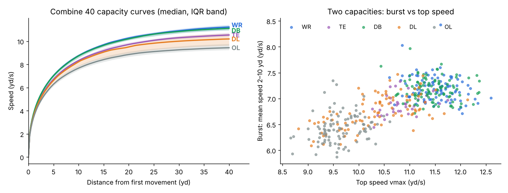

# Sprint capacity curves (Combine 40)

_Generated 2026-10-16 by `scripts/capacity_curves.py`; model in `src/bdb27/capacity.py`._

Each tracked 40 attempt's reported speed is fit with the mono-exponential sprint model v(t) = vmax(1 − e^{−(t−t0)/τ}) (Samozino et al. 2016). The start time t0 is a free parameter, which absorbs inconsistent clip trimming. Derived capacities: a0 = vmax/τ (initial acceleration = relative horizontal force F0/m), d90 (distance to 90% of vmax), curve-implied 10-yd and 40 times from first movement, and peak relative power a0·vmax/4. Usable attempts have R² ≥ 0.97, RMSE ≤ 0.45 yd/s and a run of at least 38 yd. Player values are means over usable reps.

**Chosen capacities.**

- **Top speed `vmax`**, from the model fit. Use the model, not the observed peak, because 97% of clips end while the runner is still accelerating or at speed.
- **Burst `burst2_10`**: mean speed from 2 to 10 yd, timed from first movement. The model's τ and a0 are reported, but they are poorly identified from a 3-point-stance start.

**Correction (2026-10-16).** The pooled retest ICCs below overstate within-group reliability. Within WRs, burst2_10 has a single-rep ICC of only 0.15, so its low redundancy with the stopwatch among WRs is mostly noise, not a hidden second capacity. Burst is reliable within DL (0.81) and moderate for TE, DB and OL (0.48-0.64). vmax is reliable in every group (0.80-0.97). See the within-group table.

## Fit quality

|   attempts |   fit failed |   usable |   median R2 |   median RMSE (yd/s) |   median t0 (s) |   players |   players usable |
|-----------:|-------------:|---------:|------------:|---------------------:|----------------:|----------:|-----------------:|
|        793 |            0 |      782 |       0.995 |                0.201 |           0.066 |       418 |              418 |

## Validation against the official stopwatch (fastest curve-implied time vs official best)

| group   | time        |   n |      r |   bias_s |   mae_s |
|:--------|:------------|----:|-------:|---------:|--------:|
| all     | 40          | 418 |  0.966 |    0.246 |   0.247 |
| all     | 10-yd split | 418 |  0.776 |    0.282 |   0.282 |
| WR      | 40          |  94 |  0.674 |    0.242 |   0.245 |
| WR      | 10-yd split |  94 | -0.011 |    0.299 |   0.3   |
| TE      | 40          |  34 |  0.824 |    0.244 |   0.244 |
| TE      | 10-yd split |  34 |  0.289 |    0.315 |   0.315 |
| DB      | 40          | 102 |  0.716 |    0.249 |   0.249 |
| DB      | 10-yd split | 102 |  0.194 |    0.306 |   0.306 |
| DL      | 40          |  93 |  0.954 |    0.252 |   0.252 |
| DL      | 10-yd split |  93 |  0.69  |    0.251 |   0.251 |
| OL      | 40          |  95 |  0.836 |    0.241 |   0.242 |
| OL      | 10-yd split |  95 |  0.532 |    0.258 |   0.258 |

## Retest reliability (players with 2 usable reps)

Pooled across all groups. This **overstates** reliability for within-group comparisons, because between-group differences (e.g. OL vs WR speed) count as true variance. Use the next table for within-group work.

| param      |   nPlayers |   retest_r |   ICC |   within_sd |
|:-----------|-----------:|-----------:|------:|------------:|
| vmax       |        364 |      0.971 | 0.97  |       0.157 |
| tau        |        364 |      0.506 | 0.5   |       0.115 |
| a0         |        364 |      0.591 | 0.59  |       0.703 |
| d90        |        364 |      0.649 | 0.644 |       2.011 |
| tModel10   |        364 |      0.809 | 0.808 |       0.051 |
| tModel40   |        364 |      0.96  | 0.96  |       0.064 |
| pmaxRel    |        364 |      0.82  | 0.82  |       1.653 |
| split2_10  |        364 |      0.818 | 0.817 |       0.031 |
| split10_20 |        364 |      0.98  | 0.98  |       0.01  |
| split20_40 |        244 |      0.992 | 0.992 |       0.013 |
| v10        |        364 |      0.943 | 0.943 |       0.124 |
| v10rel     |        364 |      0.693 | 0.689 |       0.019 |
| burst2_10  |        364 |      0.805 | 0.805 |       0.182 |

### Within-group retest ICC (single rep)

| param     |    WR |    TE |    DB |    DL |    OL |
|:----------|------:|------:|------:|------:|------:|
| burst2_10 | 0.141 | 0.555 | 0.482 | 0.811 | 0.642 |
| split2_10 | 0.161 | 0.554 | 0.483 | 0.815 | 0.61  |
| tModel40  | 0.479 | 0.791 | 0.72  | 0.958 | 0.839 |
| vmax      | 0.795 | 0.862 | 0.836 | 0.97  | 0.859 |

## Redundancy: CV R² of each capacity parameter from stopwatch + weight, within group

Lower is better here: the remaining share is information the stopwatch does not carry.

| group   | param      |   n |   forty+10yd+weight |   forty+weight |
|:--------|:-----------|----:|--------------------:|---------------:|
| DB      | a0         | 102 |              -0.049 |         -0.028 |
| DB      | burst2_10  | 102 |               0.052 |          0.094 |
| DB      | pmaxRel    | 102 |               0.148 |          0.169 |
| DB      | split20_40 |  86 |               0.697 |          0.708 |
| DB      | split2_10  | 102 |               0.054 |          0.097 |
| DB      | v10rel     | 102 |              -0.044 |         -0.015 |
| DB      | vmax       | 102 |               0.544 |          0.545 |
| DL      | a0         |  93 |              -0.003 |          0.034 |
| DL      | burst2_10  |  93 |               0.544 |          0.553 |
| DL      | pmaxRel    |  93 |               0.574 |          0.589 |
| DL      | split20_40 |  79 |               0.977 |          0.972 |
| DL      | split2_10  |  93 |               0.558 |          0.567 |
| DL      | v10rel     |  93 |               0.299 |          0.295 |
| DL      | vmax       |  93 |               0.904 |          0.9   |
| OL      | a0         |  95 |               0.054 |          0.01  |
| OL      | burst2_10  |  95 |               0.22  |          0.241 |
| OL      | pmaxRel    |  95 |               0.22  |          0.229 |
| OL      | split20_40 |  88 |               0.906 |          0.852 |
| OL      | split2_10  |  95 |               0.234 |          0.256 |
| OL      | v10rel     |  95 |               0.194 |          0.002 |
| OL      | vmax       |  95 |               0.824 |          0.705 |
| TE      | a0         |  34 |              -0.187 |         -0.088 |
| TE      | burst2_10  |  34 |               0.298 |          0.365 |
| TE      | pmaxRel    |  34 |               0.226 |          0.304 |
| TE      | split20_40 |  30 |               0.849 |          0.871 |
| TE      | split2_10  |  34 |               0.312 |          0.378 |
| TE      | v10rel     |  34 |              -0.174 |         -0.035 |
| TE      | vmax       |  34 |               0.665 |          0.674 |
| WR      | a0         |  94 |              -0.164 |         -0.146 |
| WR      | burst2_10  |  94 |              -0.122 |         -0.092 |
| WR      | pmaxRel    |  94 |              -0.033 |         -0.01  |
| WR      | split20_40 |  93 |               0.769 |          0.768 |
| WR      | split2_10  |  94 |              -0.137 |         -0.103 |
| WR      | v10rel     |  94 |              -0.13  |         -0.124 |
| WR      | vmax       |  94 |               0.534 |          0.529 |

## Within-group correlations of the chosen capacities

| group   |   n |   r(vmax,burst2_10) |   r(vmax,forty) |   r(burst2_10,forty) |   r(burst2_10,tenYdSplit) |   r(burst2_10,combineWeight) |   r(vmax,combineWeight) |
|:--------|----:|--------------------:|----------------:|---------------------:|--------------------------:|-----------------------------:|------------------------:|
| WR      |  94 |               -0.22 |           -0.75 |                -0.28 |                     -0.05 |                         0.09 |                   -0.24 |
| TE      |  34 |                0.35 |           -0.84 |                -0.66 |                     -0.3  |                         0.05 |                   -0.14 |
| DB      | 102 |               -0.06 |           -0.75 |                -0.4  |                     -0.26 |                        -0.04 |                   -0.29 |
| DL      |  93 |                0.62 |           -0.95 |                -0.79 |                     -0.76 |                        -0.71 |                   -0.8  |
| OL      |  95 |                0.22 |           -0.84 |                -0.58 |                     -0.58 |                        -0.07 |                   -0    |

## Coverage of capacity estimates (all 510 prospects)

Top speed is imputed from the official forty and weight (within-group linear fit, CV R² 0.73 for WR/TE) when no 40 is tracked. The WR go route was tested as a fallback and rejected: go-route peak vs vmax r = 0.37, and imputation from go-route peak plus weight has CV R² 0.08. Burst is never imputed.

| combinePosition   |   imputed_forty |   none |   tracked |
|:------------------|----------------:|-------:|----------:|
| DB                |               2 |     18 |       102 |
| DL                |               1 |     24 |        93 |
| OL                |               0 |     26 |        95 |
| TE                |               0 |      8 |        34 |
| WR                |               3 |     10 |        94 |

## Parameter correlations (all players)

|            |   vmax |    a0 |   d90 |   split2_10 |   v10rel |   split20_40 |
|:-----------|-------:|------:|------:|------------:|---------:|-------------:|
| vmax       |   1    |  0.36 |  0.74 |       -0.74 |    -0.71 |        -0.98 |
| a0         |   0.36 |  1    | -0.34 |       -0.86 |     0.35 |        -0.54 |
| d90        |   0.74 | -0.34 |  1    |       -0.12 |    -0.95 |        -0.6  |
| split2_10  |  -0.74 | -0.86 | -0.12 |        1    |     0.11 |         0.86 |
| v10rel     |  -0.71 |  0.35 | -0.95 |        0.11 |     1    |         0.6  |
| split20_40 |  -0.98 | -0.54 | -0.6  |        0.86 |     0.6  |         1    |

## Group medians (yd/s, s, yd; SI: F0 N/kg, Pmax W/kg and W)

| combinePosition   |   n |   vmax |   tau |   a0 |   d90 |   tModel40 |   f0Rel |   pmaxRelW |    pmax |
|:------------------|----:|-------:|------:|-----:|------:|-----------:|--------:|-----------:|--------:|
| WR                |  94 |  11.52 |  1.3  | 8.83 | 20.93 |       4.74 |    8.07 |      21.31 | 1899.53 |
| TE                |  34 |  10.77 |  1.31 | 8.11 | 20.28 |       4.99 |    7.41 |      18.52 | 2115.05 |
| DB                | 102 |  11.4  |  1.3  | 8.8  | 20.66 |       4.76 |    8.05 |      21.06 | 1856.97 |
| DL                |  93 |  10.39 |  1.26 | 8.19 | 18.1  |       5.07 |    7.49 |      17.78 | 2240.61 |
| OL                |  95 |   9.59 |  1.28 | 7.49 | 17.24 |       5.43 |    6.85 |      15.2  | 2151.58 |

