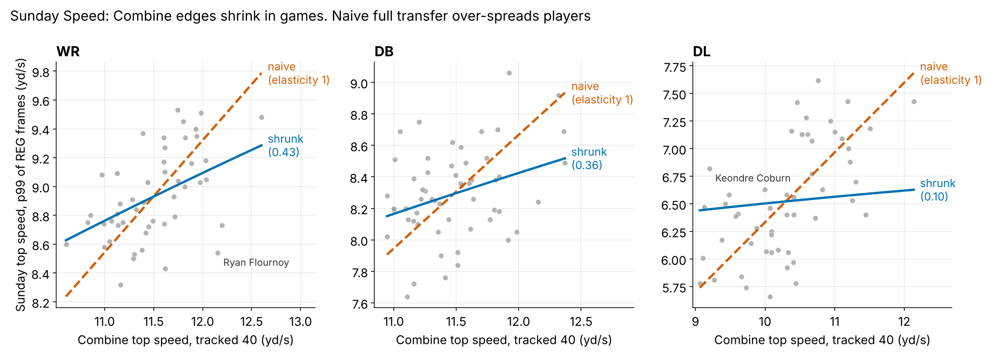

# Sunday Speed: projecting NFL game top speed from the Combine

_Generated 2026-10-16 by `scripts/sunday_speed.py`. Per-player table: `data/processed/sunday_speed_players.parquet`._

## Summary

- **Target: "Sunday top speed" = the 90th percentile of a player's per-play peak speed** (all REG plays, whole play,
  >= 200 plays). It is the speed he reaches on his fastest one-in-ten plays. Split-half reliability
  (alternating games, Spearman-Brown) is WR 0.92, DB 0.70, DL 0.94. That beats frame-level
  p99 (DB 0.56) and is comparable to the context-adjusted window intercept (WR 0.89, DB 0.74,
  DL 0.95), and it reads directly as a top speed in yd/s / mph. The window intercept is kept as a robustness target.
- **Shrunk beats naive full transfer by a clear margin, in every group.** Leave-one-draft-class-out RMSE: naive
  0.405 vs shrunk 0.327 yd/s (difference 0.077, 95% CI 0.047 to 0.108;
  19% lower). It holds for WR, DB and DL separately and on the window target. Naive calibration slopes are
  WR 0.53, DB 0.01, DL 0.63: taking the stopwatch at face value spreads players out 1.5-2x
  too much (DB: no signal at all). Shrunk slopes are WR 0.94, DB 0.31, DL 0.97.
- **Most of the gain is shrinkage to body type, not speed.** Beyond weight, Combine speed improves the projection only
  for WR (weight-only minus shrunk RMSE +0.049 yd/s, CI 0.002 to 0.095; elasticity
  0.49). For DB (elasticity 0.01) and DL (-0.09) on this whole-play target, weight carries the
  signal: the shrunk model is no better than weight alone (DL: slightly worse, -0.026 yd/s). On the
  route/rush-window target, the weight-controlled elasticities are WR 0.23, DB 0.27 and DL 0.35,
  consistent with "forty cents on the dollar".
- **Stopwatch equivalent: yes.** Official forty + weight matches tracking vmax + weight (pooled RMSE difference
  +0.002 yd/s, CI -0.009 to 0.013), and adding vmax to the forty adds nothing.
- **Uncertainty.** The 80% prediction interval is about ±0.7 mph. Held-out coverage is 80%
  (WR 81%, DB 78%, DL 80%), so the bands are honest.

| group   |   n |   elasticity (c) |   RMSE naive |   RMSE group mean |   RMSE weight only |   RMSE shrunk | naive - shrunk [95% CI]   |   RMSE forty+wt | forty - shrunk [95% CI]   |   calib naive |   calib shrunk |   80% PI coverage |
|:--------|----:|-----------------:|-------------:|------------------:|-------------------:|--------------:|:--------------------------|----------------:|:--------------------------|--------------:|---------------:|------------------:|
| WR      |  48 |            0.486 |        0.325 |             0.353 |              0.309 |         0.26  | 0.065 [0.014, 0.114]      |           0.281 | +0.021 [-0.011, 0.053]    |         0.53  |          0.935 |             0.812 |
| DB      |  55 |            0.01  |        0.366 |             0.253 |              0.255 |         0.259 | 0.107 [0.055, 0.156]      |           0.258 | -0.001 [-0.006, 0.004]    |         0.005 |          0.312 |             0.782 |
| DL      |  51 |           -0.093 |        0.501 |             0.557 |              0.407 |         0.433 | 0.068 [0.015, 0.122]      |           0.425 | -0.007 [-0.023, 0.007]    |         0.635 |          0.965 |             0.804 |
| all     | 154 |                  |        0.405 |             0.406 |              0.328 |         0.327 | 0.077 [0.047, 0.108]      |           0.329 | +0.002 [-0.009, 0.013]    |         0.461 |          0.912 |             0.799 |

## How a scout uses this

Do not read a prospect's Combine top speed as his game speed. Read the **projected Sunday speed and its 80% band**
(group + weight + tracked vmax, or official forty, which works equally well). For receivers, 1 mph of extra Combine
top speed buys about 0.5 mph on Sundays. For DBs and DL, the band is mostly set by position and body
weight, so a fast 40 should not move the speed projection. Two prospects whose bands overlap (about ±0.7 mph)
are the same speed for planning purposes. The naive column is what "trusting the stopwatch" implies. The players
it misses most (section 4) are where the scout should look at film for the reason: role, injury, or effort.
The separation column (section 5) is a rough illustration, not a validated effect.

## 1. Choosing the game-speed target (split-half by alternating games, Spearman-Brown)

Whole-play halves need >= 100 plays per half. Window-intercept halves need >= 20 windows per half and refit the context + window-length mixed model of `scripts/translation.py` on each half.

| group   | target                                     |   players |   split-half r |   Spearman-Brown reliability |
|:--------|:-------------------------------------------|----------:|---------------:|-----------------------------:|
| WR      | window random intercept (context-adjusted) |        63 |          0.8   |                        0.889 |
| WR      | per-play peak, 90th pct (chosen)           |        49 |          0.856 |                        0.923 |
| WR      | per-play peak, 80th pct                    |        49 |          0.909 |                        0.952 |
| WR      | frame speed p99                            |        49 |          0.864 |                        0.927 |
| WR      | frame speed p99.9                          |        49 |          0.628 |                        0.771 |
| DB      | window random intercept (context-adjusted) |        62 |          0.591 |                        0.743 |
| DB      | per-play peak, 90th pct (chosen)           |        64 |          0.54  |                        0.701 |
| DB      | per-play peak, 80th pct                    |        64 |          0.623 |                        0.768 |
| DB      | frame speed p99                            |        64 |          0.393 |                        0.564 |
| DB      | frame speed p99.9                          |        64 |          0.429 |                        0.6   |
| DL      | window random intercept (context-adjusted) |        60 |          0.898 |                        0.946 |
| DL      | per-play peak, 90th pct (chosen)           |        63 |          0.893 |                        0.943 |
| DL      | per-play peak, 80th pct                    |        63 |          0.896 |                        0.945 |
| DL      | frame speed p99                            |        63 |          0.858 |                        0.923 |
| DL      | frame speed p99.9                          |        63 |          0.722 |                        0.838 |

Across players, the chosen target and the window intercept correlate r = WR 0.78, DB 0.27, DL 0.66. Top-N means of play peaks were rejected: they rise with snap count.

Modeling sample (tracked 40, official forty, weight, >= 200 REG plays): WR 48, DB 55, DL 51 players.

## 2. Out-of-sample projection accuracy (yd/s)

Models are fit on the log scale within group. (a) uses the training-group mean ratio of game to Combine vmax (elasticity 1); (b) is the training-group mean; (c0)-(e) are OLS on the log predictors. Calibration slope is the slope of observed on predicted (1 = ideal; < 1 = predictions too spread). It is undefined for the group mean.

### Leave-one-draft-class-out (train on two classes, predict the third)

| group   | model                       |   n |   RMSE |   MAE |   calibration slope |
|:--------|:----------------------------|----:|-------:|------:|--------------------:|
| WR      | (a) naive full transfer     |  48 |  0.325 | 0.263 |               0.53  |
| WR      | (b) group mean              |  48 |  0.353 | 0.291 |                     |
| WR      | (b2) weight only            |  48 |  0.309 | 0.252 |               0.824 |
| WR      | (c0) elasticity only        |  48 |  0.301 | 0.236 |               0.824 |
| WR      | (c) shrunk: vmax + weight   |  48 |  0.26  | 0.218 |               0.935 |
| WR      | (d) official forty + weight |  48 |  0.281 | 0.232 |               0.825 |
| WR      | (e) vmax + forty + weight   |  48 |  0.264 | 0.219 |               0.876 |
| DB      | (a) naive full transfer     |  55 |  0.366 | 0.302 |               0.005 |
| DB      | (b) group mean              |  55 |  0.253 | 0.188 |                     |
| DB      | (b2) weight only            |  55 |  0.255 | 0.195 |               0.416 |
| DB      | (c0) elasticity only        |  55 |  0.258 | 0.192 |              -2.219 |
| DB      | (c) shrunk: vmax + weight   |  55 |  0.259 | 0.198 |               0.312 |
| DB      | (d) official forty + weight |  55 |  0.258 | 0.197 |               0.353 |
| DB      | (e) vmax + forty + weight   |  55 |  0.259 | 0.196 |               0.324 |
| DL      | (a) naive full transfer     |  51 |  0.501 | 0.407 |               0.635 |
| DL      | (b) group mean              |  51 |  0.557 | 0.465 |                     |
| DL      | (b2) weight only            |  51 |  0.407 | 0.322 |               1.04  |
| DL      | (c0) elasticity only        |  51 |  0.485 | 0.397 |               0.949 |
| DL      | (c) shrunk: vmax + weight   |  51 |  0.433 | 0.36  |               0.965 |
| DL      | (d) official forty + weight |  51 |  0.425 | 0.354 |               1.02  |
| DL      | (e) vmax + forty + weight   |  51 |  0.425 | 0.354 |               0.976 |
| all     | (a) naive full transfer     | 154 |  0.405 | 0.324 |               0.461 |
| all     | (b) group mean              | 154 |  0.406 | 0.312 |                     |
| all     | (b2) weight only            | 154 |  0.328 | 0.255 |               0.96  |
| all     | (c0) elasticity only        | 154 |  0.36  | 0.273 |               0.884 |
| all     | (c) shrunk: vmax + weight   | 154 |  0.327 | 0.258 |               0.912 |
| all     | (d) official forty + weight | 154 |  0.329 | 0.26  |               0.914 |
| all     | (e) vmax + forty + weight   | 154 |  0.325 | 0.256 |               0.905 |

### Repeated 5-fold CV (40 repeats, mean)

| group   | model                       |   RMSE |   MAE |   calibration slope |
|:--------|:----------------------------|-------:|------:|--------------------:|
| DB      | (a) naive full transfer     |  0.354 | 0.287 |              -0.006 |
| DB      | (b) group mean              |  0.257 | 0.192 |                     |
| DB      | (b2) weight only            |  0.243 | 0.184 |               0.69  |
| DB      | (c0) elasticity only        |  0.261 | 0.196 |              -3.465 |
| DB      | (c) shrunk: vmax + weight   |  0.247 | 0.187 |               0.589 |
| DB      | (d) official forty + weight |  0.246 | 0.186 |               0.609 |
| DB      | (e) vmax + forty + weight   |  0.25  | 0.189 |               0.513 |
| DL      | (a) naive full transfer     |  0.5   | 0.415 |               0.633 |
| DL      | (b) group mean              |  0.555 | 0.46  |                     |
| DL      | (b2) weight only            |  0.419 | 0.333 |               0.961 |
| DL      | (c0) elasticity only        |  0.489 | 0.404 |               0.884 |
| DL      | (c) shrunk: vmax + weight   |  0.423 | 0.339 |               0.942 |
| DL      | (d) official forty + weight |  0.423 | 0.337 |               0.948 |
| DL      | (e) vmax + forty + weight   |  0.43  | 0.349 |               0.902 |
| WR      | (a) naive full transfer     |  0.32  | 0.259 |               0.548 |
| WR      | (b) group mean              |  0.341 | 0.278 |                     |
| WR      | (b2) weight only            |  0.302 | 0.249 |               0.849 |
| WR      | (c0) elasticity only        |  0.295 | 0.232 |               0.884 |
| WR      | (c) shrunk: vmax + weight   |  0.261 | 0.217 |               0.927 |
| WR      | (d) official forty + weight |  0.274 | 0.227 |               0.889 |
| WR      | (e) vmax + forty + weight   |  0.265 | 0.22  |               0.893 |

### Paired contrasts (LODO predictions, bootstrap over players)

| group   | RMSE(A) - RMSE(B)                                       |   yd/s |   lo95 |   hi95 |   % of A |
|:--------|:--------------------------------------------------------|-------:|-------:|-------:|---------:|
| WR      | (a) naive full transfer - (c) shrunk: vmax + weight     |  0.065 |  0.014 |  0.114 |   20.044 |
| WR      | (b) group mean - (c) shrunk: vmax + weight              |  0.093 |  0.039 |  0.149 |   26.441 |
| WR      | (b2) weight only - (c) shrunk: vmax + weight            |  0.049 |  0.002 |  0.095 |   15.951 |
| WR      | (d) official forty + weight - (c) shrunk: vmax + weight |  0.021 | -0.011 |  0.053 |    7.639 |
| WR      | (d) official forty + weight - (e) vmax + forty + weight |  0.017 | -0.005 |  0.038 |    6.027 |
| DB      | (a) naive full transfer - (c) shrunk: vmax + weight     |  0.107 |  0.055 |  0.156 |   29.241 |
| DB      | (b) group mean - (c) shrunk: vmax + weight              | -0.006 | -0.032 |  0.016 |   -2.393 |
| DB      | (b2) weight only - (c) shrunk: vmax + weight            | -0.004 | -0.01  |  0.002 |   -1.71  |
| DB      | (d) official forty + weight - (c) shrunk: vmax + weight | -0.001 | -0.006 |  0.004 |   -0.538 |
| DB      | (d) official forty + weight - (e) vmax + forty + weight | -0.001 | -0.005 |  0.003 |   -0.442 |
| DL      | (a) naive full transfer - (c) shrunk: vmax + weight     |  0.068 |  0.015 |  0.122 |   13.518 |
| DL      | (b) group mean - (c) shrunk: vmax + weight              |  0.124 |  0.056 |  0.194 |   22.269 |
| DL      | (b2) weight only - (c) shrunk: vmax + weight            | -0.026 | -0.053 | -0.002 |   -6.369 |
| DL      | (d) official forty + weight - (c) shrunk: vmax + weight | -0.007 | -0.023 |  0.007 |   -1.757 |
| DL      | (d) official forty + weight - (e) vmax + forty + weight |  0.001 | -0.023 |  0.022 |    0.141 |
| all     | (a) naive full transfer - (c) shrunk: vmax + weight     |  0.077 |  0.047 |  0.108 |   19.144 |
| all     | (b) group mean - (c) shrunk: vmax + weight              |  0.078 |  0.043 |  0.111 |   19.31  |
| all     | (b2) weight only - (c) shrunk: vmax + weight            |  0.001 | -0.017 |  0.019 |    0.341 |
| all     | (d) official forty + weight - (c) shrunk: vmax + weight |  0.002 | -0.009 |  0.013 |    0.575 |
| all     | (d) official forty + weight - (e) vmax + forty + weight |  0.004 | -0.007 |  0.015 |    1.32  |

### Robustness: the context-adjusted route/rush-window level as the target (LODO, yd/s of window peak speed)

The `elasticity` row reports the coefficient in the RMSE column.

| group   | model                        |   n |   RMSE |   MAE |   calibration slope | CI              |
|:--------|:-----------------------------|----:|-------:|------:|--------------------:|:----------------|
| WR      | (a) naive full transfer      |  64 |  0.247 | 0.184 |               0.274 |                 |
| WR      | (b) group mean               |  64 |  0.187 | 0.15  |                     |                 |
| WR      | (b2) weight only             |  64 |  0.174 | 0.136 |               0.834 |                 |
| WR      | (c) shrunk: vmax + weight    |  64 |  0.168 | 0.132 |               0.806 |                 |
| WR      | (d) official forty + weight  |  64 |  0.171 | 0.133 |               0.753 |                 |
| WR      | naive - shrunk RMSE [95% CI] |  64 |  0.079 |       |                     | [0.029, 0.124]  |
| WR      | elasticity (c), full sample  |  64 |  0.231 |       |                     |                 |
| DB      | (a) naive full transfer      |  63 |  0.178 | 0.141 |               0.282 |                 |
| DB      | (b) group mean               |  63 |  0.154 | 0.126 |                     |                 |
| DB      | (b2) weight only             |  63 |  0.151 | 0.124 |               0.541 |                 |
| DB      | (c) shrunk: vmax + weight    |  63 |  0.15  | 0.126 |               0.569 |                 |
| DB      | (d) official forty + weight  |  63 |  0.145 | 0.122 |               0.765 |                 |
| DB      | naive - shrunk RMSE [95% CI] |  63 |  0.028 |       |                     | [0.003, 0.052]  |
| DB      | elasticity (c), full sample  |  63 |  0.272 |       |                     |                 |
| DL      | (a) naive full transfer      |  61 |  0.225 | 0.192 |               0.936 |                 |
| DL      | (b) group mean               |  61 |  0.332 | 0.291 |                     |                 |
| DL      | (b2) weight only             |  61 |  0.208 | 0.162 |               1.039 |                 |
| DL      | (c) shrunk: vmax + weight    |  61 |  0.198 | 0.165 |               1.041 |                 |
| DL      | (d) official forty + weight  |  61 |  0.2   | 0.163 |               1.011 |                 |
| DL      | naive - shrunk RMSE [95% CI] |  61 |  0.028 |       |                     | [-0.000, 0.054] |
| DL      | elasticity (c), full sample  |  61 |  0.354 |       |                     |                 |

## 3. 2025 class: held-out projections vs actual (trained on 2023-24 only; first 8 picks per group)

| name                  | group   |   pick |   forty |   vmax (mph) |   naive (mph) | Sunday proj (mph) [80%]   |   actual (mph) |   miss shrunk (mph) |
|:----------------------|:--------|-------:|--------:|-------------:|--------------:|:--------------------------|---------------:|--------------------:|
| Malaki Starks         | DB      |     27 |    4.5  |         24.2 |          16.5 | 15.8 [15.2, 16.5]         |           15.6 |               -0.2  |
| Maxwell Hairston      | DB      |     30 |    4.28 |         25.2 |          17.1 | 16.2 [15.5, 17.0]         |           16.1 |               -0.18 |
| Trey Amos             | DB      |     61 |    4.43 |         23.5 |          16   | 15.8 [15.2, 16.5]         |           16.2 |                0.4  |
| Darien Porter         | DB      |     68 |    4.3  |         24.9 |          16.9 | 15.9 [15.2, 16.6]         |           15.4 |               -0.52 |
| Nohl Williams         | DB      |     85 |    4.5  |         24.2 |          16.5 | 15.8 [15.1, 16.4]         |           16.1 |                0.3  |
| Jonas Sanker          | DB      |     93 |    4.48 |         24.2 |          16.4 | 15.6 [14.9, 16.2]         |           15.9 |                0.37 |
| Upton Stout           | DB      |    100 |    4.44 |         23.7 |          16.1 | 16.3 [15.6, 17.0]         |           16.2 |               -0.02 |
| Craig Woodson         | DB      |    106 |    4.45 |         23.5 |          16   | 15.7 [15.1, 16.4]         |           15.2 |               -0.51 |
| Darius Alexander      | DL      |     65 |    4.95 |         20.6 |          12.1 | 11.7 [10.7, 12.9]         |           11.4 |               -0.32 |
| Princely Umanmielen   | DL      |     77 |    4.72 |         21.8 |          12.8 | 13.5 [12.3, 14.8]         |           13.8 |                0.31 |
| Jordan Burch          | DL      |     78 |    4.67 |         23.4 |          13.7 | 12.4 [11.2, 13.7]         |           12.3 |               -0.1  |
| C.J. West             | DL      |    113 |    4.95 |         20.8 |          12.2 | 11.5 [10.4, 12.6]         |           11.3 |               -0.19 |
| Joshua Farmer         | DL      |    137 |    5.11 |         20   |          11.7 | 11.7 [10.7, 12.9]         |           12.2 |                0.5  |
| Tyrion Ingram-Dawkins | DL      |    139 |    4.86 |         21.4 |          12.5 | 12.5 [11.4, 13.7]         |           10.5 |               -2.03 |
| Elijah Roberts        | DL      |    157 |    4.78 |         21.9 |          12.9 | 12.2 [11.1, 13.4]         |           11.5 |               -0.78 |
| Yahya Black           | DL      |    164 |    5.39 |         18.6 |          10.9 | 11.1 [10.0, 12.2]         |           11.7 |                0.6  |
| Jayden Higgins        | WR      |     34 |    4.47 |         23.1 |          17.4 | 17.3 [16.6, 18.0]         |           17.5 |                0.23 |
| Luther Burden         | WR      |     39 |    4.41 |         24.5 |          18.5 | 17.8 [17.1, 18.6]         |           18   |                0.12 |
| Isaac TeSlaa          | WR      |     70 |    4.43 |         24.3 |          18.4 | 17.7 [16.9, 18.4]         |           18.6 |                0.9  |
| Pat Bryant            | WR      |     74 |    4.61 |         22.8 |          17.2 | 17.3 [16.7, 18.0]         |           17.7 |                0.37 |
| Jaylin Noel           | WR      |     79 |    4.39 |         24   |          18.2 | 17.9 [17.2, 18.6]         |           17.9 |               -0.07 |
| Chimere Dike          | WR      |    103 |    4.34 |         24.2 |          18.3 | 17.9 [17.2, 18.7]         |           18   |                0.09 |
| Dont'e Thornton       | WR      |    108 |    4.3  |         24.6 |          18.6 | 17.9 [17.2, 18.6]         |           18.3 |                0.41 |
| Arian Smith           | WR      |    110 |    4.36 |         24.5 |          18.5 | 18.4 [17.6, 19.1]         |           19.1 |                0.73 |

## 4. Biggest misses of naive full transfer (LODO, all classes)

**Tests fast, plays slower** (naive projection far above the game):

| name                  | group   | pick   |   forty |   vmax (mph) |   naive (mph) | Sunday proj (mph) [80%]   |   actual (mph) |   draftYear |   miss naive (mph) |   miss shrunk (mph) |
|:----------------------|:--------|:-------|--------:|-------------:|--------------:|:--------------------------|---------------:|------------:|-------------------:|--------------------:|
| Tyrion Ingram-Dawkins | DL      | 139    |    4.86 |         21.4 |          12.5 | 12.5 [11.4, 13.7]         |           10.5 |        2025 |              -2.07 |               -2.03 |
| Jaylon Carlies        | DB      | 151    |    4.5  |         24.1 |          16.1 | 15.7 [15.0, 16.4]         |           14.1 |        2024 |              -2.04 |               -1.58 |
| Ryan Flournoy         | WR      | 216    |    4.44 |         24.9 |          18.9 | 18.2 [17.5, 19.0]         |           17   |        2024 |              -1.84 |               -1.19 |
| Jalen Redmond         | DL      | UDFA   |    4.81 |         21.1 |          12.3 | 11.9 [10.8, 13.1]         |           10.7 |        2023 |              -1.58 |               -1.2  |
| Xavier Legette        | WR      | 32     |    4.39 |         24.9 |          18.9 | 17.9 [17.1, 18.7]         |           17.4 |        2024 |              -1.53 |               -0.52 |
| Dante Stills          | DL      | 213    |    4.85 |         21.3 |          12.4 | 12.0 [11.0, 13.2]         |           10.8 |        2023 |              -1.53 |               -1.19 |
| Darien Porter         | DB      | 68     |    4.3  |         24.9 |          16.9 | 15.9 [15.2, 16.6]         |           15.4 |        2025 |              -1.53 |               -0.52 |
| Jordan Burch          | DL      | 78     |    4.67 |         23.4 |          13.7 | 12.4 [11.2, 13.7]         |           12.3 |        2025 |              -1.43 |               -0.1  |

**Plays faster than he tests** (naive projection far below the game):

| name              | group   | pick   |   forty |   vmax (mph) |   naive (mph) | Sunday proj (mph) [80%]   |   actual (mph) |   draftYear |   miss naive (mph) |   miss shrunk (mph) |
|:------------------|:--------|:-------|--------:|-------------:|--------------:|:--------------------------|---------------:|------------:|-------------------:|--------------------:|
| Keondre Coburn    | DL      | 194    |    5.22 |         18.8 |          10.9 | 11.3 [10.2, 12.4]         |           13.2 |        2023 |               2.23 |                1.91 |
| Marshawn Kneeland | DL      | 56     |    4.75 |         21.4 |          12.3 | 12.6 [11.4, 13.9]         |           14.4 |        2024 |               2.08 |                1.83 |
| Austin Booker     | DL      | 144    |    4.79 |         21.2 |          12.2 | 13.3 [11.9, 14.8]         |           14   |        2024 |               1.81 |                0.76 |
| Terrion Arnold    | DB      | 24     |    4.5  |         22.6 |          15.1 | 15.8 [15.2, 16.4]         |           16.9 |        2024 |               1.77 |                1.12 |
| Eric Watts        | DL      | UDFA   |    4.67 |         22   |          12.7 | 12.4 [11.3, 13.7]         |           14.2 |        2024 |               1.53 |                1.76 |
| Leonard Taylor    | DL      | UDFA   |    5.12 |         19.4 |          11.2 | 11.7 [10.6, 12.9]         |           12.7 |        2024 |               1.52 |                0.99 |
| Cam Hart          | DB      | 140    |    4.5  |         22.9 |          15.4 | 15.7 [15.2, 16.3]         |           16.8 |        2024 |               1.44 |                1.06 |
| Javon Solomon     | DL      | 168    |    4.72 |         21.7 |          12.5 | 13.1 [11.9, 14.5]         |           13.8 |        2024 |               1.38 |                0.72 |

## 5. Payoff: illustrative separation value on vertical routes (WR)

**Rough illustration, not a validated effect.** Within a player, a 1-SD faster vertical rep (SD = 1.01 yd/s within player × route) comes with +0.11 yd separation. Across WRs, 1 yd/s of Sunday top speed goes with 0.70 yd/s of mean vertical-route peak speed. Chaining those gives about 0.074 yd of separation per yd/s (0.036 yd per mph) of projected Sunday speed, relative to the average WR. This borrows a within-player slope for between-player differences.

| player                           |   vmax (mph) |   naive proj (mph) |   shrunk proj (mph) |   sep. edge naive (yd) |   sep. edge shrunk (yd) |
|:---------------------------------|-------------:|-------------------:|--------------------:|-----------------------:|------------------------:|
| fastest WR vmax: Isaiah Bond     |       25.774 |             19.461 |              18.903 |                  0.06  |                   0.041 |
| slowest WR vmax: Isaiah Williams |       21.693 |             16.379 |              17.344 |                 -0.051 |                  -0.015 |

## 6. Pre-draft view: prospects with a tracked 40 but no usable NFL target (earliest picks)

This shows how the tool is used before the draft: a projection and band from Combine data alone.

| name            | group   |   draftYear |   pick |   REG plays |   forty |   vmax (mph) |   naive (mph) | Sunday proj (mph) [80%]   |   sep. edge, illustrative (yd) |
|:----------------|:--------|------------:|-------:|------------:|--------:|-------------:|--------------:|:--------------------------|-------------------------------:|
| Isaiah Foskey   | DL      |        2023 |     40 |         181 |    4.58 |         22.9 |          13.3 | 12.7 [11.6, 14.0]         |                                |
| Cam Smith       | DB      |        2023 |     51 |         153 |    4.43 |         24.3 |          16.3 | 16.2 [15.6, 16.9]         |                                |
| Kyle Williams   | WR      |        2025 |     69 |         178 |    4.4  |         23.8 |          18   | 18.0 [17.3, 18.7]         |                           0.01 |
| Landon Jackson  | DL      |        2025 |     72 |          30 |    4.68 |         22.4 |          13   | 12.7 [11.6, 14.0]         |                                |
| Bralen Trice    | DL      |        2024 |     74 |           0 |    4.72 |         21.5 |          12.5 | 13.4 [12.2, 14.8]         |                                |
| Jermaine Burton | WR      |        2024 |     80 |          96 |    4.45 |         23.9 |          18   | 17.9 [17.2, 18.6]         |                           0.01 |
| Roman Wilson    | WR      |        2024 |     84 |         155 |    4.39 |         23.7 |          17.9 | 18.1 [17.4, 18.8]         |                           0.01 |
| Caleb Ransaw    | DB      |        2025 |     88 |           0 |    4.33 |         23.7 |          15.9 | 15.8 [15.1, 16.4]         |                                |
| Elijah Jones    | DB      |        2024 |     90 |          37 |    4.44 |         24.6 |          16.5 | 16.1 [15.4, 16.8]         |                                |
| Jaylin Smith    | DB      |        2025 |     97 |          31 |    4.45 |         25.2 |          17   | 16.0 [15.4, 16.7]         |                                |
| Siaki Ika       | DL      |        2023 |     98 |          99 |    5.39 |         18   |          10.5 | 11.1 [10.1, 12.3]         |                                |
| Tai Felton      | WR      |        2025 |    102 |          21 |    4.37 |         25.1 |          19   | 18.6 [17.9, 19.4]         |                           0.03 |

All 289 WR/DB/DL prospects with a tracked 40 are in the parquet (154 with an NFL target, 135 without).
