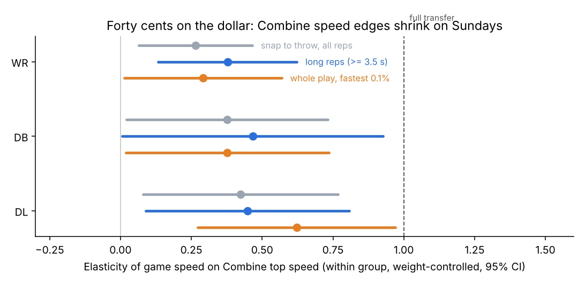

# Combine-to-game translation of sprint capacity

_Generated 2026-10-16 by `scripts/translation.py`._

## Summary (2026-10-16)

- **Forty cents on the dollar.** Within a position group and holding body weight fixed, a Combine top-speed
  edge shows up in game speed at an elasticity of about **0.3-0.5**: WR 0.27 overall and 0.38 on long vertical
  routes; DB 0.38-0.47; DL 0.42-0.45. A WR who is 5% faster at the Combine is about 2% faster on Sundays.
- **The shrinkage is not window truncation.** Whole-play maximum speed (fastest 0.1% of frames, including after
  the catch and in pursuit) gives WR 0.29-0.36, DB 0.38 and DL 0.62 with weight controlled. At that top end, WRs
  reach only about 84% of their Combine top speed.
- **Pooling groups overstates transfer.** WR+TE pooled gives 0.82, and DL without a weight control gives 1.0.
  Those mostly reflect body type and role (TE vs WR, DT vs edge), not translation.
- **Combine burst cannot be translated for WRs.** Its within-WR retest ICC is only 0.15. DL burst is
  reliable (0.81) and transfers at about 0.6 (disattenuated), but adds nothing beyond the official forty
  at the player level.
- **Beyond the stopwatch: no.** For every group, tracking vmax/burst adds about 0 to log pick + size + forty
  when predicting a player's game speed or burst level.
- **Faster reps still pay, within player.** WR vertical routes: +0.10 yd separation per SD; breaking routes:
  +2.8 pp target probability. DL: a quicker get-off gives +2.6 to 3.2 pp pressure per SD (the whole-rush speed
  coefficients are inflated by reverse causality).

Game windows run from the snap to the throw or sack. WRs are measured on routes run (TEs are excluded, with too few players), DB on coverage snaps of thrown passes, DL on pass-rush snaps (NGS get-off recorded). All are REG only. Capacities come from the Combine 40 (`docs/capacity.md`). Burst is mean path speed from 2 to 10 yd; in games it is only measured with no speed at the snap and no motion.

## Samples

| group   |   windows |   players |   with capacity |   median window (s) |   reach 10 yd of path |
|:--------|----------:|----------:|----------------:|--------------------:|----------------------:|
| WR      |     35341 |        83 |              75 |                 2.8 |                 0.661 |
| DB      |     34798 |        92 |              80 |                 2.6 |                 0.273 |
| DL      |     33417 |        98 |              78 |                 3.2 |                 0.348 |

## Reliability of the Combine capacity (log scale)

| group   | capacity   |   ICC single rep |   mean reps |   reliability of player mean |
|:--------|:-----------|-----------------:|------------:|-----------------------------:|
| DB      | vmax       |            0.836 |       1.853 |                        0.904 |
| DB      | burst2_10  |            0.483 |       1.853 |                        0.634 |
| DL      | vmax       |            0.97  |       1.903 |                        0.984 |
| DL      | burst2_10  |            0.813 |       1.903 |                        0.892 |
| OL      | vmax       |            0.864 |       1.874 |                        0.922 |
| OL      | burst2_10  |            0.627 |       1.874 |                        0.759 |
| TE      | vmax       |            0.861 |       1.941 |                        0.923 |
| TE      | burst2_10  |            0.555 |       1.941 |                        0.708 |
| WR      | vmax       |            0.796 |       1.83  |                        0.877 |
| WR      | burst2_10  |            0.152 |       1.83  |                        0.247 |

## 1. Elasticities: log(game) ~ log(Combine) + context + (1 | player)

An elasticity of 1 means Combine differences between players show up fully in games. `disattenuated` divides by the reliability of the player's Combine mean.

| group   | capacity   |   elasticity |   lo95 |   hi95 |   reliability |   disattenuated |   game/Combine median |   windows |   players |
|:--------|:-----------|-------------:|-------:|-------:|--------------:|----------------:|----------------------:|----------:|----------:|
| WR      | speed      |        0.342 |  0.133 |  0.55  |         0.877 |           0.39  |                 0.615 |     28764 |        65 |
| WR      | burst      |       -0.016 | -0.184 |  0.153 |         0.247 |          -0.064 |                 0.866 |     17739 |        60 |
| DB      | speed      |        0.39  |  0.029 |  0.751 |         0.904 |           0.431 |                 0.407 |     30455 |        64 |
| DB      | burst      |        0.102 | -0.201 |  0.405 |         0.634 |           0.161 |                 0.682 |      5496 |        48 |
| DL      | speed      |        0.984 |  0.741 |  1.227 |         0.984 |           1     |                 0.367 |     18527 |        62 |
| DL      | burst      |        0.525 |  0.182 |  0.869 |         0.892 |           0.589 |                 0.489 |      7914 |        47 |

### Top-speed sensitivity: body weight and long windows

The long windows test whether short snap-to-throw windows compress speed differences: WR vertical routes, DB deep or man coverage, DL all rushes, each lasting at least 3.5 s.

| group   | spec                    |   elasticity |   lo95 |   hi95 |   game/Combine median |   windows |   players |
|:--------|:------------------------|-------------:|-------:|-------:|----------------------:|----------:|----------:|
| WR      | + Combine weight        |        0.265 |  0.065 |  0.465 |                 0.615 |     28764 |        65 |
| WR      | long windows (>= 3.5 s) |        0.481 |  0.222 |  0.741 |                 0.714 |      2946 |        62 |
| WR      | long windows + weight   |        0.378 |  0.133 |  0.623 |                 0.714 |      2946 |        62 |
| DB      | + Combine weight        |        0.376 |  0.02  |  0.732 |                 0.407 |     30455 |        64 |
| DB      | long windows (>= 3.5 s) |        0.443 | -0.031 |  0.916 |                 0.549 |      3086 |        55 |
| DB      | long windows + weight   |        0.466 |  0.007 |  0.926 |                 0.549 |      3086 |        55 |
| DL      | + Combine weight        |        0.424 |  0.08  |  0.768 |                 0.367 |     18527 |        62 |
| DL      | long windows (>= 3.5 s) |        0.856 |  0.59  |  1.122 |                 0.402 |      4622 |        64 |
| DL      | long windows + weight   |        0.449 |  0.09  |  0.809 |                 0.402 |      4622 |        64 |

Whole-play maximum speed (fastest 1% / 0.1% of each player's REG frames, including after the catch and in pursuit) gives the same picture: `scripts/eda/max_speed_elasticity.py`, `data/processed/eda/max_speed_elasticity.csv`.

## 2. Beyond the stopwatch: game speed/burst level from log pick + size + official forty, then + tracking

| group   | outcome        | added     |   n |   cvR2 base |   cvR2 +added |   delta |   delta lo95 |   delta hi95 |
|:--------|:---------------|:----------|----:|------------:|--------------:|--------:|-------------:|-------------:|
| WR      | gameSpeedLevel | vmax      |  65 |       0.18  |         0.189 |   0.009 |       -0.08  |        0.125 |
| WR      | gameSpeedLevel | burst2_10 |  64 |       0.173 |         0.205 |   0.033 |       -0.14  |        0.089 |
| WR      | gameBurstLevel | vmax      |  60 |       0.024 |         0.018 |  -0.006 |       -0.148 |       -0.006 |
| WR      | gameBurstLevel | burst2_10 |  60 |       0.024 |         0.03  |   0.006 |       -0.092 |        0.017 |
| DB      | gameSpeedLevel | vmax      |  64 |      -0.024 |        -0.084 |  -0.061 |       -0.179 |       -0.024 |
| DB      | gameSpeedLevel | burst2_10 |  63 |       0.005 |        -0.013 |  -0.019 |       -0.052 |        0.043 |
| DB      | gameBurstLevel | vmax      |  48 |      -0.182 |        -0.251 |  -0.069 |       -0.068 |        0.024 |
| DB      | gameBurstLevel | burst2_10 |  48 |      -0.182 |        -0.265 |  -0.082 |       -0.189 |       -0.01  |
| DL      | gameSpeedLevel | vmax      |  62 |       0.57  |         0.55  |  -0.021 |       -0.032 |        0.029 |
| DL      | gameSpeedLevel | burst2_10 |  61 |       0.561 |         0.543 |  -0.018 |       -0.116 |       -0.014 |
| DL      | gameBurstLevel | vmax      |  47 |       0.303 |         0.215 |  -0.089 |       -0.62  |       -0.066 |
| DL      | gameBurstLevel | burst2_10 |  47 |       0.303 |         0.267 |  -0.036 |       -0.08  |        0.013 |

## 3. Within-player payoff of faster reps (player FE, cluster-robust SE; z within player × route/alignment)

| group   | subset   | rep metric (within-player z)   | outcome         |   coef per SD |   lo95 |   hi95 |     p |     n |   players |
|:--------|:---------|:-------------------------------|:----------------|--------------:|-------:|-------:|------:|------:|----------:|
| WR      | vertical | peakSpeed                      | separation (yd) |         0.106 |  0.055 |  0.156 | 0     | 10233 |        67 |
| WR      | vertical | peakSpeed                      | target (prob)   |         0.008 | -0.002 |  0.018 | 0.125 | 10233 |        67 |
| WR      | breaking | peakSpeed                      | separation (yd) |        -0.009 | -0.066 |  0.048 | 0.764 |  8726 |        68 |
| WR      | breaking | peakSpeed                      | target (prob)   |         0.029 |  0.017 |  0.041 | 0     |  8726 |        68 |
| WR      | short    | peakSpeed                      | separation (yd) |        -0.132 | -0.201 | -0.063 | 0     |  6780 |        65 |
| WR      | short    | peakSpeed                      | target (prob)   |         0.012 |  0     |  0.024 | 0.043 |  6780 |        65 |
| WR      | vertical | burst                          | separation (yd) |        -0.006 | -0.062 |  0.05  | 0.827 |  7466 |        67 |
| WR      | vertical | burst                          | target (prob)   |        -0.011 | -0.021 | -0.002 | 0.02  |  7466 |        67 |
| WR      | breaking | burst                          | separation (yd) |         0.068 |  0.005 |  0.131 | 0.034 |  5975 |        62 |
| WR      | breaking | burst                          | target (prob)   |        -0.011 | -0.025 |  0.002 | 0.089 |  5975 |        62 |
| WR      | short    | burst                          | separation (yd) |         0     | -0.101 |  0.102 | 0.999 |  2586 |        61 |
| WR      | short    | burst                          | target (prob)   |         0.003 | -0.014 |  0.019 | 0.76  |  2586 |        61 |
| DL      | EDGE     | peakSpeed                      | pressure (prob) |         0.074 |  0.062 |  0.086 | 0     |  9938 |        57 |
| DL      | INTERIOR | peakSpeed                      | pressure (prob) |         0.063 |  0.054 |  0.072 | 0     |  8889 |        62 |
| DL      | EDGE     | burst                          | pressure (prob) |         0.117 |  0.094 |  0.141 | 0     |  2810 |        44 |
| DL      | INTERIOR | burst                          | pressure (prob) |         0.18  |  0.148 |  0.212 | 0     |  1143 |        40 |
| DL      | EDGE     | quickGetOff                    | pressure (prob) |         0.032 |  0.026 |  0.039 | 0     |  9938 |        57 |
| DL      | INTERIOR | quickGetOff                    | pressure (prob) |         0.026 |  0.019 |  0.032 | 0     |  8889 |        62 |

**Caveat (DL).** Peak speed and 2-10 yd burst are measured over the whole rush, so they partly *result* from beating the block: free rushers accelerate toward the QB. Their pressure coefficients overstate the causal payoff. `quickGetOff` (negated NGS get-off, the first steps before contact) is the cleaner rep measure. For short WR routes, the negative separation coefficients reflect receivers settling into soft spots (slower and more open), not a cost of speed.
