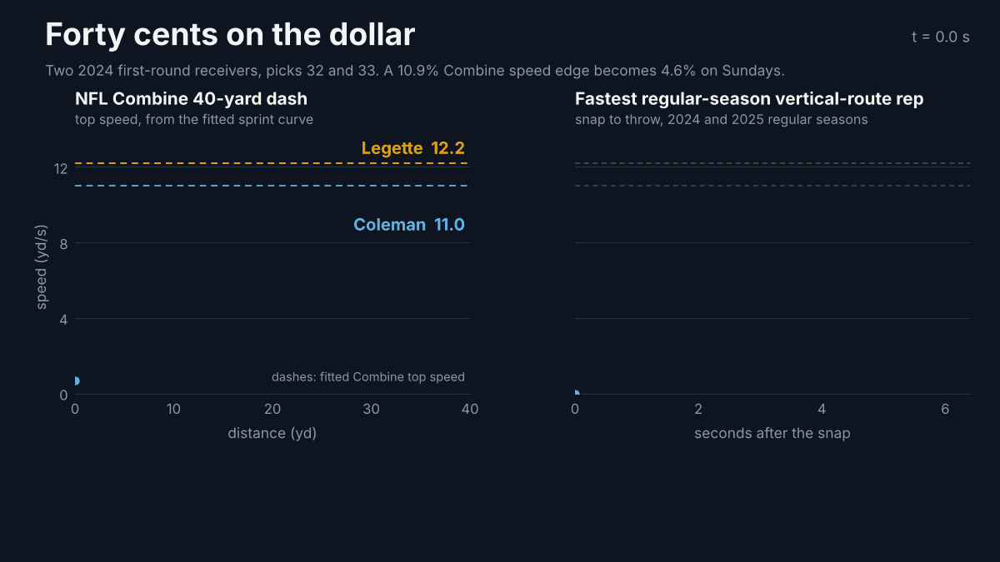
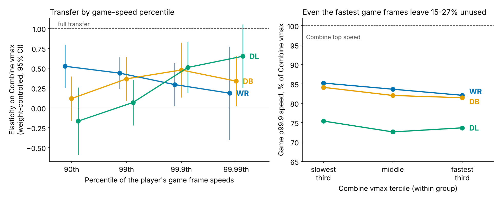

# Forty Cents on the Dollar: How Much Combine Speed Survives to Sunday

*NFL Big Data Bowl 2027, Combine to NFL Performance*

*Figure 1. Xavier Legette and Keon Coleman, picks 32 and 33 in 2024. Legette's 10.9% Combine top-speed edge (left) shrinks to 4.6% on their fastest regular-season vertical routes (right): 36 cents on the dollar, close to the receiver estimates.*

## The question every scout already asks

A receiver runs 4.35. Another runs 4.45. Every draft room hears that tenth of a second and wonders how much of
it will show up on Sundays. Until now, nobody could check. The stopwatch ends at 40 yards, and game speed was
measured on a different system for different players.

The 2027 data closes that loop for the first time: the same 510 prospects were tracked at 10 Hz both at the
Combine and in every regular-season snap of 2023–2025. We use it to measure a **translation rate**: for every
1% of Combine top speed a prospect has over a peer at his position, how much faster is he in NFL games?

**About 0.4%. Within a position, a Combine speed edge is worth roughly forty cents on the dollar (0.3–0.6 across
positions and definitions of game speed). For defensive backs and linemen on everyday plays, it is worth close to nothing.**

## Data and approach

**Combine capacity (tracking, not stopwatch).** We fit each tracked 40-yard dash (793 attempts by 418
prospects) with the sprint model used in sports science, v(t) = vmax(1 − e−(t−t₀)/τ).
The start time t₀ is a free parameter, so inconsistently trimmed clips do not bias the fit (median R² 0.995).
Top speed vmax extrapolates beyond the end of the clip, which matters because 97% of clips end
with the runner still at speed. The curve-implied 40 matches the official time (r = 0.97, with a
constant +0.25 s offset from the start trigger). vmax repeats rep to rep with ICC 0.80–0.97
within every position group.

**Game speed.** For each regular-season snap we measure the player's peak speed from the snap to the throw
(or sack): 35k WR routes, 35k DB coverage snaps on thrown passes, and 33k DL pass rushes. A mixed model
removes situational demand (route or coverage assignment, alignment, time to throw, down and distance, field
position, cushion, season), leaving each player's game-speed level.

**Translation rate.** We regress log game speed on log Combine top speed within each position group,
controlling for body weight and the context above, with a player random effect. The slope is an
elasticity: 1 means Combine differences show up in full, and 0 means they vanish.

*Figure 2. Combine-to-game elasticity of top speed by position group, under three definitions of game speed.
Points are estimates and bars are 95% CIs.*

## Result 1: speed edges shrink, typically by half or more

| Group | All reps (snap → throw) | Long reps (≥ 3.5 s) | Whole play, fastest 0.1% |
|---|---|---|---|
| WR | 0.27 [0.07, 0.47] | 0.38 [0.13, 0.62] | 0.29 [0.01, 0.57] |
| DB | 0.38 [0.02, 0.73] | 0.47 [0.01, 0.93] | 0.38 [0.02, 0.74] |
| DL | 0.42 [0.08, 0.77] | 0.45 [0.09, 0.81] | 0.62 [0.27, 0.97] |

*Table 1. Elasticities, weight-controlled, within position.*

- **It is not a short-route artifact.** Restricting to long vertical routes, or to each player's fastest
  0.1% of frames anywhere in a play (after the catch, in pursuit), gives the same range. At that extreme,
  receivers reach about 84% of their Combine top speed.
- **It is not measurement noise.** Combine top speed is highly repeatable within groups. Correcting for its
  error moves WR from 0.27 to about 0.31.
- **Pooling hides it.** Pool WR with TE, or ignore DL body weight, and transfer looks complete (0.82–1.0). That
  pooled number measures body type, not translation.

## Result 2: what explains the shrinkage

*Figure 3. Left: transfer by how fast a player's game frames are; Combine speed mostly separates players only in
rare all-out moments. Right: even a player's fastest 0.1% of game frames reach just 73–85% of his Combine top
speed, and the fastest testers leave slightly more unused.*

**Headroom, not noise.** Combine measurement error explains only 1–7% of the shortfall, because vmax
reliability would have to be about 0.3–0.4 to explain all of it. What explains it is that the game rarely asks for
top speed. Receivers and DBs top out at about 82–85% of their Combine top speed, and DL at about 74%, even on
their single fastest moments. For DB and DL, Combine speed separates players mainly in those rare all-out frames
(elasticity about 0.5 at the 99.9th percentile of a player's frames). For DB and DL it barely ranks typical game speed
(90th percentile: 0.12 and −0.17). Speed on Sundays is set by the play, not the engine.

**A stable discount.** We tested 80 moderator interactions, and none survives a false-discovery correction
(smallest q = 0.17). Within the same player, transfer does not rise from the rookie year to years 2–3 (WR
+0.12 [−0.15, 0.38]). It does not depend on draft round. The gap between fast and slow players does not close in the fourth quarter
or in blowouts.
One exploratory lead: edge rushers and high-snap DL appear to keep more of their speed than interior or
rotational linemen.

## Result 3: where speed pays, within the same player

Shrunk or not, speed is valuable. Comparing a player's faster and slower reps on the same route type removes
talent and draft-slot confounding:

- **WR vertical routes (go, post, corner, wheel):** +0.10 yd separation at the throw per SD of rep speed
  [0.06, 0.15].
- **WR breaking routes (in, out, cross):** no separation change, but +2.8 pp target probability per SD
  [1.7, 3.9].
- **WR short routes:** faster reps show *less* separation, because receivers who settle into soft spots are
  slower and open. This is not a cost of speed.
- **DL:** a quicker get-off (NGS, first steps before contact) adds +3.2 pp pressure probability per SD on the
  edge and +2.6 pp inside.

## Sunday Speed: a projection scouts can use

We turn the translation into a projection of each prospect's **Sunday Speed**: the speed he reaches on his
fastest one-in-ten NFL plays. This target is very repeatable (split-half reliability: WR 0.92, DL 0.94, DB 0.70).
We fit the projection within position on Combine top speed and weight, and test it out of sample by
training on two draft classes and predicting the third.

| Projection (RMSE, yd/s; leave-one-class-out) | WR | DB | DL |
|---|---|---|---|
| Naive: Combine speed transfers in full | 0.325 | 0.366 | 0.501 |
| Position average only | 0.353 | **0.253** | 0.557 |
| Weight only | 0.309 | 0.255 | **0.407** |
| Shrunk: Combine top speed + weight | **0.260** | 0.259 | 0.433 |
| Official forty + weight | 0.281 | 0.258 | 0.425 |

*Table 2. Out-of-sample accuracy for 154 WR/DB/DL with 200+ plays (48/55/51). Bold is the best per group.*

- **Naive full transfer is the worst projection in every group.** It spreads players 1.6–1.9× too far apart.
  Overall, the shrunk projection is 19% more accurate (0.077 yd/s [0.047, 0.108]), and its 80% intervals
  (about ±0.7 mph) cover 80% of held-out players.
- **Speed only earns its place for receivers.** On these everyday fast plays the elasticity is WR 0.49, but DB
  0.01 and DL −0.09. Combine speed beats weight alone only for WRs (by 0.049 yd/s [0.002, 0.095]). For DL,
  weight sorts game speed; for DBs, nothing at the Combine does better than the position average. The roughly
  40% transfer for DB and DL appears only in the all-out moments of Figure 3.
- **The official forty is about as good.** Tracking top speed edges it for WRs (0.260 vs 0.281), but the
  difference is within noise (0.021 yd/s [−0.011, 0.053]).

*Figure 4. Sunday Speed against Combine top speed. Dashed: naive full transfer. Solid: the shrunk projection.*

**Tests fast, plays slower.** The largest naive misses are all players whose Combine speed far outran their
game speed:
- DL Tyrion Ingram-Dawkins: projected naively at 12.5 mph, actual 10.5.
- DB Jaylon Carlies.
- WR Ryan Flournoy: 4.44 forty, 1.8 mph below his naive projection.
- WR Xavier Legette.

For the 2025 class, trained only on 2023–24, the shrunk projection put first-year receivers within a mile per
hour. Examples: Luther Burden projected 17.8 mph vs 18.0 actual, and Arian Smith 18.4 vs 19.1.

## What the tracking adds, and what it doesn't

We tested whether tracking-derived capacity (top speed, 2–10 yd burst) predicts game speed, separation over
expected, target rate or pressure *beyond* draft slot, the official forty and size. With 60–85 players per
group, it does not: no tracking measure improves on that baseline (best ΔR² +0.03). The tracked 40 is not a better stopwatch. Its value is
that it is **on the same scale as game tracking**, which is what makes a translation rate measurable at all.
We also report what did not survive:
- the 2–10 yd "burst" is unreliable within receivers (retest ICC 0.15);
- skill-drill change-of-direction features do not repeat across drills;
- the share of capacity used does not predict separation better than raw speed.

## How a team would use this

- **Draft season.** Discount 40-time gaps between same-position prospects by at least 60% when projecting game
  speed. For DB and DL, project game speed from weight and role, not 40 speed. Among receivers, put the speed
  premium on vertical stems, where faster reps actually earn separation.
- **In season, week to week.** Track each player's game top speed against his own Sunday Speed projection. A
  sustained drop below projection could flag soft-tissue or return-to-play cases. This use is proposed, not
  validated here.
- **Development.** For DL, get-off is the speed lever that pays (pressure per SD of quicker first step).

## Limitations

- **Selection.** Only players who earn snaps have game speed. Draft slot predicts playing time (R² 0.37–0.64),
  and 40–45% of each group lacks a usable per-snap sample.
- **Exposure.** The 2025 class has one season.
- **Missing tracked 40s.** About 18% of prospects lack one.
- **No opponents.** Game tracking covers only the cohort, so speed is never measured against a specific
  defender.
- **Small samples.** Elasticity CIs are wide for DB.

## Appendix

Code: [public Kaggle notebook link TBD]. Repository modules: `bdb27.capacity` (sprint fits), `bdb27.usage`
(game windows), `scripts/translation.py` (elasticities), `scripts/shrinkage.py`, `scripts/sunday_speed.py`.
